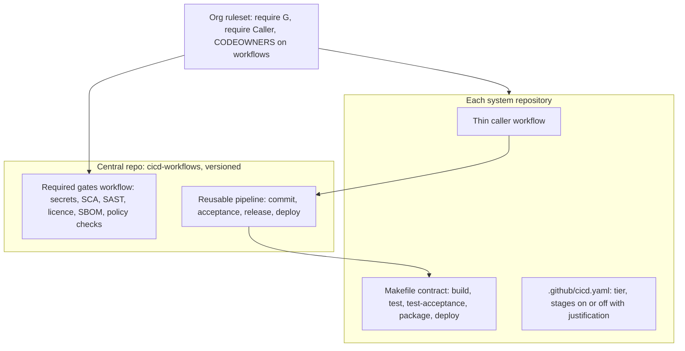

# CI/CD pipeline design review

**Scope:** All seven workflows in `.github/workflows`, the `scan-secrets` action
and `dependabot.yaml` were read. The other four actions, which wrap `make`
targets, were not read. Nothing was run. The GitHub feature details in section 5
should be checked against current GitHub documentation before you commit to
them, because they change often.

## 1. Current design

```mermaid
flowchart LR
    PR[push or PR] --> M[metadata]
    M --> C[1 Commit: secrets, format, links, shell lint]
    C --> T[2 Test: unit tests, Sonar]
    T -->|only if PR exists| B[3 Build: placeholder]
    B --> A[4 Acceptance: placeholder, 7 parallel suites]
    A -.->|no artefact link| P[cicd-2 publish: on PR merged, gh release]
    P -.->|manual, tag input| D[cicd-3 deploy: placeholder]
```

### What is already good

- Actions are pinned to full SHAs with version comments.
- Dependabot is configured with a 7-day cooldown, which defends against
  supply-chain attacks on freshly published versions.
- Permissions are least-privilege (`contents: read` by default).
- Every job has a `timeout-minutes`.
- Runner images are pinned and tool versions come from `mise.toml`, a single
  source of truth.
- The pipeline is split into reusable stage workflows with documented time
  budgets.
- The commit stage runs in parallel, scans the full git history for secrets and
  fails closed on gitleaks.
- Acceptance tests run in parallel against a created environment, and teardown
  uses `if: always()`.
- CI logic lives behind `make` targets, so developers can run the same checks
  locally.
- The Sonar job always reports, so it can be a required check without blocking
  unconfigured repositories.

## 2. Assessment against Continuous Delivery principles

| Principle (Humble and Farley)                                                  | Status       | Evidence                                                                                                                                |
| ------------------------------------------------------------------------------ | ------------ | --------------------------------------------------------------------------------------------------------------------------------------- |
| Every commit is a release candidate                                            | Partial      | The release is cut on PR close from a different SHA than the one that was tested.                                                       |
| Build once, deploy the same binary everywhere                                  | **Not met**  | The build, publish and deploy jobs have no artefact handoff (all `TODO`). Deploy takes a tag and checks out the default branch.         |
| Commit stage is fast (under 5 minutes) and gives high confidence               | Partial      | Unit tests sit in a separate stage after the commit stage. There is no compile, static analysis or dependency scan in the commit stage. |
| Acceptance tests run on every release candidate                                | Partial      | Build and acceptance are skipped on pushes without a PR, including pushes to `main`. They exist only as stubs.                          |
| Automate everything and keep the pipeline the only path to production          | Not met      | Deploy is a manual `workflow_dispatch` stub with no environment, gate or approval.                                                      |
| Stop the line when it breaks                                                   | Not met      | There is no failure notification. Only success is notified.                                                                             |
| Fast, visible feedback and measurement                                         | Not met      | No DORA metrics, no pipeline duration or flakiness tracking.                                                                            |
| Configuration, infrastructure and DB changes are versioned and in the pipeline | Placeholder  | Echo stubs only.                                                                                                                        |
| Fail closed                                                                    | Weak         | Unconfigured Sonar passes green, and all `echo make test-*` steps pass silently.                                                        |
| Trunk-based development and small batches                                      | Not enforced | Nothing limits branch lifetime, and `push: "**"` plus `pull_request` runs duplicate workflows.                                          |
| Security built into the pipeline                                               | Partial      | Only secrets scanning and Sonar. No SCA, container scan, SBOM, provenance or signing.                                                   |

## 3. Defects and risks in the current skeleton

### High

1. **Script injection in deploy.**
   `echo "tag=${{ github.event.inputs.tag }}" >> $GITHUB_OUTPUT` and
   `export TAG="${{ ... }}"` interpolate user input directly into shell. Pass
   inputs through `env:` and validate them against a pattern.
2. **Mutable deploy input.** The deploy tag defaults to `"latest"`. A deployment
   must reference an immutable version or digest. The deploy job also checks out
   the default branch, not the tag.
3. **Publish version is unreliable.** `cicd-1` runs
   `make version-create-effective-file`, but `cicd-2` does not. `cicd-2` reads
   `.version` (the committed `VERSION` is upper-case and the effective file is
   generated), so it falls back to `unknown`. The `gh release create` step would
   then publish "unknown".
4. **No artefact promotion.** Nothing links the artefact tested in acceptance to
   the one that is released or deployed. This is the central CD invariant.
5. **Placeholders pass green.** If this template is mandated as-is, repositories
   pass the gate without testing anything. Stubs must fail, or be marked as not
   applicable through an explicit, audited opt-out.

### Medium

1. **Duplicate and gated triggers.** `push: **` plus `pull_request` runs every
   PR twice. The `gh pr list` check is a workaround, and it makes results depend
   on timing. Use `pull_request` plus `merge_group` for validation and `push` on
   `main` for release candidates.
2. **Release candidate identity.** `pull_request: closed` is the wrong trigger
   for publishing. Use `push` to `main` (or the merge queue result), so that the
   tested SHA is the released SHA.
3. **No `concurrency` control.** Stale runs are not cancelled on PRs, and
   publish and deploy runs are not serialised.
4. **Sonar and fork PRs.** Fork PRs get no secrets, so analysis is skipped and
   reports green. That is acceptable for open-source contributions but must be
   explicit policy for internal systems.
5. **Notifications.** The Teams message uses placeholder text, runs on success
   only, and uses a secrets comparison to decide whether to run.
6. **Unquoted shell in metadata.** `gh pr list --head $branch_name` and
   `$GITHUB_OUTPUT` are unquoted. `GITHUB_HEAD_REF` is attacker-influenced on
   forks.
7. **No environments.** There is no GitHub Environment use, so no protection
   rules, no environment-scoped secrets and no deployment history.

### Low

1. Eight metadata inputs are repeated in every stage workflow, and metadata
   computation is copied into three workflows. Consolidate this into one
   reusable workflow or composite action.
2. `cache: true` for `mise-action` is fine in PR jobs. Disable it in release and
   publish builds to avoid cache poisoning of released artefacts.
3. `workflow_call` inputs are required strings. This is fragile for evolution
   and gives no schema for tier-specific behaviour.

## 4. Gaps to plug

### Pipeline shape (Farley's model)

- **Commit stage (under 5 minutes):** compile, unit tests, static analysis,
  linters, secrets scan, dependency (SCA) and licence checks, IaC scanning, and
  an artefact build with SBOM. Publish to an immutable store (container registry
  or GitHub Packages) addressed by digest.
- **Acceptance stage:** executable specifications written in a domain language
  and run against a production-like deployment of the actual artefact. Keep the
  functional acceptance suite distinct from the non-functional suites
  (performance, security DAST, accessibility), which can run in parallel after
  it.
- **Release or deploy stages:** automatic promotion through environments. Each
  deployment runs smoke tests, includes automated rollback or roll-forward, and
  is a single parameterised workflow reused per environment.
- **Production gate:** a manual approval via a GitHub Environment, plus
  change-evidence capture.
- **Post-deploy:** synthetic monitoring, SLO checks and a DORA metrics emitter
  (deployment frequency, lead time, change failure rate, time to restore).
- **Feedback:** failure notification to the owning team and a clear "broken
  pipeline has priority" rule.

### Controls specific to large NHS systems

- **Provenance and integrity:** SLSA-style build attestations
  (`actions/attest-build-provenance`), signed images and verification at deploy
  (`gh attestation verify`, or cosign).
- **Authentication to cloud:** OIDC federation only, with no long-lived cloud
  credentials in secrets. Scope claims by environment and ref.
- **Evidence retention:** keep test, scan and approval evidence as artefacts or
  in an evidence store, for assurance regimes (DSPT, DTAC, clinical safety
  DCB0129 and DCB0160 where relevant).
- **Database and data changes:** forward-only migrations, tested in acceptance,
  with expand and contract patterns.
- **Dark launching:** feature flags and a documented rollback strategy, so
  deployment can be decoupled from release.
- **Dependency hygiene:** Dependabot already exists. Add SCA gating, with a
  policy for severity and exceptions.
- **Workflow security:** a CODEOWNERS rule on `.github/workflows/**`, an
  organisation Actions allowlist that requires SHA pinning, and
  `pull_request_target` banned unless reviewed.

## 5. Options for enforcing required workflows

GitHub's mechanisms form a ladder from advisory to enforced.

| Option                                              | Mechanism                                                                                                                      | Strength                                                   | Weakness                                                                                                                             |
| --------------------------------------------------- | ------------------------------------------------------------------------------------------------------------------------------ | ---------------------------------------------------------- | ------------------------------------------------------------------------------------------------------------------------------------ |
| A. Template and convention (today)                  | Template repository plus starter workflows                                                                                     | Easy to adopt                                              | Teams can edit or delete workflows. No enforcement.                                                                                  |
| B. Central reusable workflows                       | `workflow_call` from a central repo, pinned by tag or SHA                                                                      | One implementation, versioned, easy to roll out            | Caller is repo-owned, so it can be removed or bypassed.                                                                              |
| C. Required status checks                           | Branch protection or ruleset requiring named checks                                                                            | Simple                                                     | Check names can be spoofed by any workflow in the repo. Weak on its own.                                                             |
| D. Organisation ruleset "Require workflows to pass" | Ruleset targets repos by name or custom property and runs a central workflow at a pinned ref                                   | Repo admins cannot remove or edit it. Strongest guarantee. | Needs a plan that supports it. Runs in each repo's context, so it needs a stable contract and careful handling of forks and secrets. |
| E. Hybrid (recommended)                             | D for the immutable "enterprise gates", B for the delivery pipeline stages, and a Makefile contract for repo-specific commands | Locked governance with real customisation                  | Needs a versioning and release process for the central workflows.                                                                    |

### Recommended design (Option E)

**Locked (cannot be changed by teams)**

- The required gates workflow (secrets, SCA, SAST, SBOM, licence, provenance
  verification) runs through the organisation ruleset.
- Artefact build, attest, store and promote-by-digest mechanics.
- Environment promotion order, approval for production, and the OIDC trust
  policy.
- Notification on failure, and metric emission.

**Customisable (by the team)**

- Makefile targets for build, test, acceptance, and deploy specifics.
- Language and runtime versions through `mise.toml`.
- Additional stages and extra checks, added after the locked ones.
- Declared opt-outs (for example "no UI tests, this is a pure API") recorded in
  `.github/cicd.yaml`, validated by the gate and reviewed through CODEOWNERS.

**Tiering through custom properties:** use a repository custom property such as
`delivery-tier` (for example `tier-1-clinical`, `tier-2-service`,
`tier-3-tooling`). The ruleset targets repositories by tier, so stricter gates
(mandatory acceptance, performance, two-person approval) apply to critical
systems.

**Versioning:** release the central workflows with semantic tags and pin
consumers by SHA. Roll out new versions through Dependabot on the callers, with
a breaking-change policy and a "canary" tier before general release.

## 6. Recommended changes to this skeleton, in order

1. **Fix the injection and the deploy input.** Use `env:`, validate the tag,
   require a digest or immutable tag, and check out that ref.
2. **Implement artefact handoff.** Build once with `upload-artifact` or a
   registry, record the digest, and attest it.
3. **Re-trigger release on `push` to `main`.** Use `merge_group` for validation,
   and derive the version once in a shared reusable metadata workflow.
4. **Remove the PR-exists gate and duplicate triggers.** Use `pull_request` plus
   `merge_group`, and add `concurrency` groups.
5. **Make stubs fail closed.** Replace `echo` with a gate that fails when a
   stage has no declared implementation or justified opt-out.
6. **Add Environments** with protection rules, and a reusable `deploy` workflow
   with smoke tests and rollback.
7. **Expand the commit stage** (SCA, SAST, SBOM, IaC scan) and keep the 5 minute
   budget measurable in CI.
8. **Add failure notifications and DORA metrics.**
9. **Create the central `cicd-workflows` repo and the organisation ruleset**
   with a custom property for tiering. Pilot on 2 or 3 repositories before
   enterprise-wide rollout.

## 7. Decisions needed

- Is your GitHub plan on Enterprise Cloud, so organisation rulesets with
  required workflows are available?
- Which artefact store is the standard (GitHub Packages, ECR, another)?
- Which production approval model applies per tier (single, dual, change-board
  evidence)?
- Are fork contributions allowed on internal systems, and how should
  secret-dependent gates behave for them?
- What is the opt-out governance for gates that do not apply to a project (who
  approves and how is it audited)?
- Is a merge queue mandatory for `main`?

## 8. Next steps on offer

- Turn sections 5 and 6 into an ADR in `docs/adr`.
- Implement items 1 to 4 of section 6 in the workflows.
