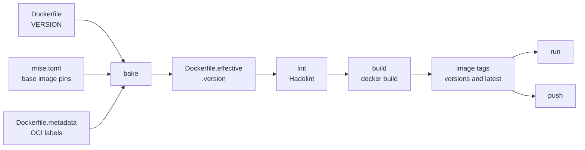

# Build Docker images 🐳

- [Build Docker images 🐳](#build-docker-images-)
  - [Overview 🧭](#overview-)
  - [How it fits together 🧩](#how-it-fits-together-)
    - [The image lifecycle](#the-image-lifecycle)
    - [Why build from a generated Dockerfile](#why-build-from-a-generated-dockerfile)
    - [Why image pins live with the toolchain pins](#why-image-pins-live-with-the-toolchain-pins)
    - [Why Make wraps Docker](#why-make-wraps-docker)
    - [From laptop to pipeline](#from-laptop-to-pipeline)
  - [Key files 📁](#key-files-)
  - [Usage 📖](#usage-)
    - [Quick start](#quick-start)
    - [Use a different image directory](#use-a-different-image-directory)
    - [Build with a pinned base image](#build-with-a-pinned-base-image)
    - [Pin a new base image](#pin-a-new-base-image)
    - [Testing your image](#testing-your-image)
  - [Conventions 📏](#conventions-)
    - [Versioning](#versioning)
    - [Base image pins](#base-image-pins)
    - [Container runtime and Podman](#container-runtime-and-podman)
    - [Variables](#variables)
    - [Platform architecture](#platform-architecture)
    - [`Dockerignore` file](#dockerignore-file)

## Overview 🧭

This guide shows how the template builds container images, and why it builds
them the way it does. It assumes you already know Docker and Make. It
concentrates on what the template adds on top of them: generated Dockerfiles,
digest-pinned base images, mandatory linting, OCI labels and versioned tags.

There are three ways to read it:

- To see it working, start with the [Quick start](#quick-start). It takes one
  small image through every stage.
- To understand the design, read [How it fits together](#how-it-fits-together-).
  It explains each moving part and the reason for it.
- To look something up, go to [Conventions](#conventions-). It is the reference
  for files, variables and defaults.

The [Docker Make targets](../../../scripts/docker/docker.lib.mk) build, lint,
run and push images from a project Dockerfile. The functions in
[docker.lib.sh](../../../scripts/docker/docker.lib.sh) bake a
`Dockerfile.effective`, apply metadata and tag images using an optional
`VERSION` file.

Before you build an image:

1. Install the [quick-start prerequisites](../../../README.md#prerequisites),
   including GNU tools and a container runtime.
2. Review and trust `mise.toml`.
3. Run `make config` to install the pinned tools.

The Docker image targets are:

| Target                           | What it does                                                                                        |
| -------------------------------- | --------------------------------------------------------------------------------------------------- |
| `make docker-bake-dockerfile`    | Generates `Dockerfile.effective` and `.version` in the image directory. It does not build an image  |
| `make docker-lint`               | Bakes the effective files, then runs Hadolint over `Dockerfile.effective`                           |
| `make docker-build`              | Bakes and lints, then builds from `Dockerfile.effective` and applies every version tag and `latest` |
| `make docker-run`                | Runs the image's primary tag. Accepts `cmd` and `args`                                              |
| `make docker-push`               | Pushes every version tag and `latest`                                                               |
| `make docker-pull-pinned-images` | Pulls every image pinned in the `[_.docker]` table of `mise.toml`. `make config` runs it            |
| `make docker-test-suite-run`     | Tests the template's Docker helpers, not your image                                                 |

The bake, lint, build, run and push targets all take the `DOCKER_IMAGE`
variable. See [Variables](#variables) for the full list.

## How it fits together 🧩

### The image lifecycle

Every image goes through the same stages, whether you build it on a laptop or in
a pipeline. You write two small files. The helper does the rest.



You maintain the `Dockerfile` and the optional `VERSION` file in the image
directory. The **bake** stage combines them with the base image pins in
`mise.toml` and the label template in `Dockerfile.metadata`. It writes
`Dockerfile.effective` and `.version` next to your files. **Lint** runs Hadolint
over the effective file, so it checks exactly what will be built. **Build** runs
`docker build` against the effective file and tags the result with every version
in `.version`, plus `latest`. From there you can **run** the image locally or
**push** its tags to a registry.

Each stage is a Make target, and each one runs the stages before it.
`make docker-build` depends on `make docker-lint`, which depends on
`make docker-bake-dockerfile`. A build therefore always starts from a freshly
generated and linted Dockerfile. `make docker-run` and `make docker-push` do not
rebuild. They use the tags recorded in `.version` by the last bake.

### Why build from a generated Dockerfile

Your Dockerfile stays small, readable and valid on its own. Its base image uses
a real tag, so a plain `docker build` still works on it. That keeps it portable,
and keeps reviews focused on your application.

The details you should not maintain by hand go into `Dockerfile.effective`
instead. These are the digest that pins the base image, and the OCI labels that
record where and when the image was built. The helper regenerates the file at
every bake. A pin update in `mise.toml` therefore reaches every image built from
that base at its next build, without anyone editing a Dockerfile.

The trade-off is that a bare `docker build` of your source Dockerfile skips the
pin, the lint and the labels. Build through Make to get all three.

### Why image pins live with the toolchain pins

`mise.toml` already pins the repository's native tools in its `[tools]` table.
The `[_.docker]` table extends that to container images. It holds the base
images you build from, and the tool images that the quality checks run, such as
Hadolint and ShellCheck. With every version in one file, every update goes
through one review process, described in
[Update Dependencies](Update_Dependencies.md).

Each pin records both a tag and a digest. The tag tells a reviewer which release
it is. The digest makes it immutable. A publisher can move a tag to new content,
but a digest always refers to the same content.

### Why Make wraps Docker

Make gives every image the same entry point and the same arguments, on any
machine. A pipeline step runs the command you already ran locally, with the same
pins, lint rules, labels and platform. The order between targets is enforced
rather than remembered, so a build cannot skip the lint. The targets also hide
the long `docker build` command line, with its platform flag and label
arguments, behind one short command.

The platform default is worth knowing early, because it surprises people on
Apple silicon. Images build for `linux/amd64` by default, to match most
deployment environments. See [Platform architecture](#platform-architecture) for
the reasons and how to change it.

### From laptop to pipeline

The template's CI/CD workflows work out one build time at the start of each run.
They pass it to every stage as the `build_datetime` input. The build stage,
[stage-3-build.yaml](../../../.github/workflows/stage-3-build.yaml), is a
placeholder for your project's artefacts. When you add an image to it, call the
same Make target and pass that input as `BUILD_DATETIME`. Every tag produced in
the run then carries the same timestamp, however long the run takes:

```yaml
- name: "🔨 Build image"
  env:
    BUILD_DATETIME: ${{ inputs.build_datetime }}
  run: make docker-build DOCKER_IMAGE=my-shiny-app
```

Passing the input through `env`, not straight into the `run` script, keeps
workflow input out of the shell command.

Docker pushes to the registry named in the image, so give a pushed image its
full name, for example `DOCKER_IMAGE=ghcr.io/org/my-shiny-app`. The default
image directory comes from the image name, so pair a full name with
`docker_dir`. Log in to the registry before you run `make docker-push`.

Every build also tags the image `latest`. It is a convenience for local work.
Deploy by a date-and-commit version tag instead. That tag identifies one build,
while `latest` moves with every build.

## Key files 📁

- Scripts
  - [`docker.lib.sh`](../../../scripts/docker/docker.lib.sh): Library of Docker
    functions loaded by the Make targets and CLI scripts
  - [`docker.lib.mk`](../../../scripts/docker/docker.lib.mk): Shared Docker Make
    targets and variables, loaded by `scripts/init.mk`. Extend them from a
    project module rather than editing them
  - [`dockerfile-linter.sh`](../../../scripts/docker/dockerfile-linter.sh):
    `Dockerfile` linter
- Configuration
  - [`mise.toml`](../../../mise.toml): Stores toolchain pins and, in its
    `[_.docker]` table, Docker image versions
  - [`hadolint.yaml`](../../../scripts/config/hadolint.yaml): `Dockerfile`
    linter configuration file
  - [`Dockerfile.metadata`](../../../scripts/docker/Dockerfile.metadata): Labels
    defined by the
    [OCI image specification](https://github.com/opencontainers/image-spec/blob/main/annotations.md),
    appended to every `Dockerfile.effective`
- Test suite
  - [`docker.test.sh`](../../../scripts/docker/tests/docker.test.sh):
    Integration tests that need a Docker daemon
  - [`docker.lib.test.sh`](../../../scripts/docker/tests/docker.lib.test.sh):
    Unit tests for the library, with `docker` stubbed
  - [`dockerfile-linter.test.sh`](../../../scripts/docker/tests/dockerfile-linter.test.sh):
    Tests for the linter, with `hadolint` and `docker` stubbed
  - [`Dockerfile`](../../../scripts/docker/tests/Dockerfile): Image definition
    for the test suite
  - [`VERSION`](../../../scripts/docker/tests/VERSION): Version patterns for the
    test suite

## Usage 📖

### Quick start

This walkthrough packages a one-line Python application as an image named
`my-shiny-app`. It takes the image through every stage of the
[lifecycle](#the-image-lifecycle) once, so you can see what each stage does. The
application and its Dockerfile are not bundled with the template. Run the
commands from the repository root.

By default, the Make targets look for an image's `Dockerfile` in
`infrastructure/images/$DOCKER_IMAGE`. The directory name is significant. It
should match the name of the image you want to create. To keep the Dockerfile
somewhere else, see
[Use a different image directory](#use-a-different-image-directory).

1. **Create the application.**

   Create a file called `main.py` in the repository root, with a familiar
   command in it:

   ```python
   print("hello world")
   ```

2. **Create the Dockerfile.**

   Make the image directory:

   ```shell
   mkdir -p infrastructure/images/my-shiny-app
   ```

   Then create `infrastructure/images/my-shiny-app/Dockerfile` with this
   content:

   ```dockerfile
   FROM python

   WORKDIR /app

   COPY ./main.py .

   CMD ["python", "main.py"]
   ```

   Note the path in the `COPY` instruction. The Dockerfile is stored in a
   subdirectory, but Docker uses the repository root as the build context, so
   all paths are relative to the root. You can't `COPY` from parent directories,
   so `COPY ../../main.py .` wouldn't work. The upside is that an image can copy
   code from anywhere in the repository.

3. **Lint the Dockerfile.**

   Run Hadolint over the Dockerfile to check for common anti-patterns:

   ```shell
   $ DOCKER_IMAGE=my-shiny-app make docker-lint
   /workdir/./infrastructure/images/my-shiny-app/Dockerfile.effective:1 DL3006 warning: Always tag the version of an image explicitly
   make[1]: *** [scripts/docker/docker.lib.mk:71: _docker] Error 1
   make: *** [scripts/docker/docker.lib.mk:52: docker-lint] Error 2
   ```

   Notice two things in the output. First, Hadolint reports against
   `Dockerfile.effective`, not your Dockerfile. The lint target bakes the
   effective file first, then checks exactly what will be built. Second, a
   warning fails the target. That is deliberate. `make docker-build` runs the
   lint first, so an image with Hadolint findings never gets built.

   Here, Hadolint found that the Dockerfile does not specify which version of
   the `python` image to use. Change its first line to:

   ```dockerfile
   FROM python:3.15.2-slim
   ```

   Run `DOCKER_IMAGE=my-shiny-app make docker-lint` again. It now prints nothing
   and succeeds.

   A literal tag like this is not pinned to a digest. It keeps the quick start
   short, but the template's convention is the pinned form. See
   [Build with a pinned base image](#build-with-a-pinned-base-image).

4. **Build the image.**

   ```shell
   DOCKER_IMAGE=my-shiny-app make docker-build
   ```

   The build bakes and lints again, then builds for the default platform. It
   also adds OCI labels that record the source repository, branch, commit, build
   time and base image. Confirm that the image has been built:

   ```shell
   docker image ls my-shiny-app
   ```

   Then look at the labels, to see what a deployed image will tell you about
   itself:

   ```shell
   docker image inspect my-shiny-app --format '{{json .Config.Labels}}'
   ```

5. **Run the image.**

   ```shell
   $ DOCKER_IMAGE=my-shiny-app make docker-run
   hello world
   ```

   Pass `cmd` to override the image's default command:

   ```shell
   DOCKER_IMAGE=my-shiny-app make docker-run cmd="python --version"
   ```

6. **Add version tags.**

   Your process might need tags that identify images by date stamp or Git commit
   hash. The template supports this with a `VERSION` file. Create
   `infrastructure/images/my-shiny-app/VERSION` with this content:

   ```text
   ${yyyy}${mm}${dd}-${hash}
   ```

   Run `DOCKER_IMAGE=my-shiny-app make docker-build` again. The helper tags the
   image as `my-shiny-app:<date>-<hash>` and `my-shiny-app:latest`. The
   date-and-commit tag identifies this build and traces it back to its source.
   `latest` moves with every build. See [Versioning](#versioning) for more on
   this.

7. **Add a `make build` shortcut.**

   There is usually one image that you most often build, run and deploy.
   Document it, and provide a shortcut, in the root-level `Makefile`. Change the
   `build` target to look like this:

   ```makefile
   build: # Build the project artefact @Build
     $(MAKE) docker-build DOCKER_IMAGE=my-shiny-app
   ```

   Replace the leading spaces in the recipe with a literal tab when you add it
   to the Makefile.

   `make build` now builds your image. Keeping this convention consistent across
   projects means new starters can be onboarded quickly, without learning a new
   set of conventions each time.

### Use a different image directory

Supply `docker_dir=<path>`, or `dir=<path>`, to use a Dockerfile outside
`infrastructure/images/`. The path is relative to the directory where Make runs.
For a service-oriented repository, you can keep the `Dockerfile` alongside the
service code, for example in `services/api/`:

```shell
DOCKER_IMAGE=api make docker-build docker_dir=services/api
```

The build context is always the directory Make runs in. Here that is the
repository root, so `COPY` paths are relative to the root, not to the Dockerfile
directory. Keep the optional `VERSION` file alongside the Dockerfile. Pass the
same image name and directory to the other image targets, such as
`make docker-run` and `make docker-push`.

If `services/api/Makefile` includes `scripts/init.mk`, you can instead run
`DOCKER_IMAGE=api make -C services/api docker-build`. The image directory
default depends on the directory Make runs in:

| Make runs in        | `DOCKER_IMAGE` | Default image directory                                 |
| ------------------- | -------------- | ------------------------------------------------------- |
| The repository root | Set            | `infrastructure/images/$DOCKER_IMAGE`, which must exist |
| The repository root | Not set        | The repository root                                     |
| Any other directory | Either         | That directory                                          |

An image directory that does not exist fails the target with
`Docker image directory not found`, whether you supplied it or it is the
default. To use the repository root as the image directory while `DOCKER_IMAGE`
is set, pass `dir=.`. `make -f services/api/Makefile` does not change directory,
so use `-C` when the service directory should be the build context.

### Build with a pinned base image

The quick start used a literal tag. This walkthrough shows the template's
convention, where the base image comes from a pin in `mise.toml`.

Automatic pinning keeps builds on the base-image content your team has chosen
and reviewed. A publisher can move a tag, but cannot replace the content
identified by its SHA-256 digest. This walkthrough uses the existing `node` pin
in [mise.toml](../../../mise.toml). Run the commands from the repository root,
after the setup described in [Overview](#overview-).

1. **Check the recorded pin.**

   ```shell
   grep '^"node" = ' mise.toml
   ```

   This prints the `node` entry from `[_.docker]`, including its tag and full
   digest. That is the base image the helper will use, rather than relying on
   the tag alone.

2. **Create the source Dockerfile and image version pattern.**

   Create these files in a new `infrastructure/images/node-tool/` directory.

   `infrastructure/images/node-tool/Dockerfile`:

   ```dockerfile
   ARG NODE_VERSION=26.12.0-slim
   FROM node:${NODE_VERSION}
   CMD ["node", "--version"]
   ```

   `infrastructure/images/node-tool/VERSION`:

   ```text
   ${yyyy}${mm}${dd}-${hash}
   ```

   The source has a readable tag and a command that prints the Node version. Its
   `ARG` default is a real tag, so the source Dockerfile still builds without
   the helper. The `FROM node:${NODE_VERSION}` form lets the helper apply the
   `node` pin. The `VERSION` pattern will give your new image a date-and-commit
   tag.

3. **Generate the effective Dockerfile and check its pin.**

   Run:

   ```shell
   DOCKER_IMAGE=node-tool make docker-bake-dockerfile
   ```

   The command creates `Dockerfile.effective` and `.version`. It does not build
   an image or change the source Dockerfile.

   The helper replaces the source `ARG` default with the pinned tag and digest.
   `infrastructure/images/node-tool/Dockerfile.effective` starts with this
   content, using the current tag and full digest from `mise.toml` instead of
   the illustrative values:

   ```dockerfile
   ARG NODE_VERSION=26.13.0-slim@sha256:<digest>
   FROM node:${NODE_VERSION}
   CMD ["node", "--version"]
   ```

   The template's metadata instructions follow these lines. Compare the
   `NODE_VERSION` value with the pin from step 1. If it has no digest, check
   that the image name matches its `[_.docker]` key exactly. Literal
   `FROM image:tag` references are not rewritten. Without a matching image pin,
   the helper may use a `[tools]` version or the source default instead.

4. **Build your image using the pinned base.**

   ```shell
   DOCKER_IMAGE=node-tool make docker-build
   ```

   This regenerates the effective files, runs Hadolint, and builds from
   `Dockerfile.effective`. Docker selects the base image by digest. Moving the
   upstream tag cannot silently change that base. The helper tags your new image
   as `node-tool:<date>-<hash>` and `node-tool:latest`.

5. **Run the image you built.**

   ```shell
   DOCKER_IMAGE=node-tool make docker-run
   ```

   This runs the date-and-commit tag and prints the Node version from the pinned
   base image.

The recorded digest identifies the **base image**, not your newly built image.
Updating the pin affects the next bake or build, not an existing image. Pinning
makes those changes reviewable, but does not prove an image is safe. Keep pins
updated through review so builds receive security fixes.

Commit the source Dockerfile and `VERSION`. Do not commit `Dockerfile.effective`
or `.version`, which the helper generates. The root `.gitignore` already
excludes `.version`, `Dockerfile.effective` and
`Dockerfile.effective.dockerignore`. Commit changes to `mise.toml` when you
update a pin.

### Pin a new base image

The example above reuses an existing `node` pin. To pin a different base image,
follow these steps. See
[Update Dependencies](Update_Dependencies.md#docker-images) for the release
cooldown and digest checks that apply when you choose a tag.

1. **Resolve the digest.**

   Choose a published tag, then resolve its digest:

   ```shell
   docker buildx imagetools inspect IMAGE:TAG --format '{{.Manifest.Digest}}'
   ```

   Replace `IMAGE` and `TAG` with the image name and tag you chose. The command
   prints the digest with its `sha256:` prefix.

2. **Record the pin.**

   Add the exact image name as a key in [mise.toml](../../../mise.toml)'s
   `[_.docker]` table, with the value `TAG@sha256:DIGEST`.

3. **Use the pin in the Dockerfile.**

   Keep a real tag as the Dockerfile `ARG` default, and use that argument in
   `FROM IMAGE:${BASE_VERSION}`:

   ```dockerfile
   ARG BASE_VERSION=TAG
   FROM IMAGE:${BASE_VERSION}
   ```

   The helper matches the `FROM` image name to `[_.docker]` and rewrites the
   argument in `Dockerfile.effective`.

4. **Check the generated pin.**

   Run `make docker-bake-dockerfile` with the image name and directory, as in
   the example above. Inspect the generated `ARG` for the digest.

5. **Commit the change.**

   Commit the source Dockerfile and `mise.toml`, not `Dockerfile.effective`.

### Testing your image

The template makes sure an image is built consistently. It cannot tell you
whether your application works inside it. That part is yours.

For the quick-start image, `DOCKER_IMAGE=my-shiny-app make docker-run` should
print `hello world` and exit successfully. The template's
`make docker-test-suite-run` tests its Docker helpers, not your image. Add
project-specific tests for your application's behaviour. For long-running
services, [Testcontainers](https://testcontainers.com/) can start an image from
your project's test suite.

Good project-specific image tests:

- Start the tag produced by `make docker-build`, rather than a different local
  image
- Wait for the service to be ready, using a log message, listening port, HTTP
  endpoint or `HEALTHCHECK`. Container start alone does not prove readiness
- Check behaviour through the application's real interface
- Run the tests after building the image, before publishing it

## Conventions 📏

This section is the reference. The walkthroughs link here when you need the
detail behind a step.

### Versioning

A `VERSION` file sets the version tags that the build applies to your image.
Place it next to the `Dockerfile` that defines the image.

The file may hold a _statically defined_ version, such as `1.2.3` or `20230601`.
It may also hold a _dynamic pattern_ based on the build time and commit hash,
for example `${yyyy}${mm}${dd}${HH}${MM}${SS}-${hash}`. The helper substitutes
the pattern during the build and writes the result to a `.version` file in the
same directory, for example `20230601153000-123abcd`.

The available placeholders are:

| Placeholder | Replaced with                   |
| ----------- | ------------------------------- |
| `${yyyy}`   | Four-digit year                 |
| `${mm}`     | Two-digit month                 |
| `${dd}`     | Two-digit day                   |
| `${HH}`     | Two-digit hour, 24-hour clock   |
| `${MM}`     | Two-digit minute                |
| `${SS}`     | Two-digit second                |
| `${hash}`   | Short Git commit hash of `HEAD` |

Dates and times are in UTC. They come from `BUILD_DATETIME` when it is set,
otherwise from the current time. See `version-create-effective-file` in
[docker.lib.sh](../../../scripts/docker/docker.lib.sh) for the implementation.

The functions in [docker.lib.sh](../../../scripts/docker/docker.lib.sh) read
`.version`. Git ignores it, so it is not checked in with other files.

A `VERSION` file can hold several entries, one per line. For instance, if it
contains:

```text
${yyyy}${mm}${dd}
${yyyy}${mm}${dd}${HH}${MM}
${yyyy}${mm}${dd}-${hash}
squirrel
```

The corresponding `.version` file generated by the `docker-build` function may
appear as:

```text
20230601
202306011530
20230601-123abcd
squirrel
```

In this case, the image is tagged with all four versions and `latest`. The first
line is the primary tag, which `make docker-run` uses. Run `make docker-push`
with the same image name and directory to push all the tags. This versioning
approach is useful for projects with multiple deployments per day.

> [!NOTE]
>
> The preferred pattern for versioning is `${yyyy}${mm}${dd}${HH}${MM}` or/and
> `${yyyy}${mm}${dd}-${hash}` for projects with a cadence of multiple
> deployments per day. This is compatible with the
> [Calendar Versioning / CalVer](https://calver.org/) convention.

### Base image pins

Base image versions are maintained in the `[_.docker]` table of the
[mise.toml](../../../mise.toml) file, located in the project's top-level
directory. The format is as follows:

```toml
[_.docker]
"image/name" = "1.0.0@sha256:1234567890...abcdef"
```

Each entry must be a single-line `"image/name" = "version"` pair. Entries in any
other form, for example multi-line strings, arrays or inline tables, are
ignored. `docker-get-image-version-and-pull` matches the image name exactly, so
a lookup for `node` never returns the pin for `cimg/node`.

The [pinned base image example](#build-with-a-pinned-base-image) shows how the
helper applies a matching pin to `Dockerfile.effective` and appends
[Dockerfile.metadata](../../../scripts/docker/Dockerfile.metadata).

This keeps the helper's base-image pin under version control without changing
the source Dockerfile. A direct Docker build of the source Dockerfile uses its
declared tag instead of the generated pin.

The `[_.docker]` table lives under the `[_]` key, which mise never uses for
toolchain resolution. Its presence does mean mise asks for `mise.toml` to be
trusted once per clone. Review the file and run `mise trust mise.toml` before
`make config`. `make config` stops until you do. Once the file is trusted, it
installs the pinned native toolchain and pulls every pinned Docker image
locally.

### Container runtime and Podman

`make docker-pull-pinned-images` uses the first operational runtime, trying
Docker then Podman. A runtime is operational when `<runtime> info` succeeds
within `CONTAINER_INFO_TIMEOUT` seconds (default `10`).

- When neither runtime is installed and operational, the target prints a warning
  and succeeds. This means `make config` still works on a machine without a
  container runtime.
- When a runtime is operational, the first failed pull or tag fails the target
  with that command's exit status. The remaining images are not pulled.

Only this pull step falls back to Podman. The other Docker functions and
scripts, including those that run the helper images, call `docker` directly.
Podman's
[CLI reference](https://docs.podman.io/en/latest/markdown/podman.1.html)
supports `alias docker=podman` for interactive shell commands, but that alias is
not available to Make recipes or scripts. On a Podman-only machine, provide a
`docker` executable on `PATH`, such as the wrapper supplied by
[`podman-docker`](https://packages.fedoraproject.org/pkgs/podman/podman-docker/)
where available. Check `docker info` before running Docker-based helpers. For
Compose, see
[Run services with Docker Compose](Run_Docker_Compose_services.md#prerequisites-).

### Variables

Set the `docker_image` or `DOCKER_IMAGE` variable for your image. Alternatively,
you can use their shorthand versions, `image` or `IMAGE`. To emphasise that it
is a global variable, using the uppercase version is recommended, depending on
your implementation.

The image targets read these variables:

| Variable                                         | Purpose                                                                                  | Default                                                                 |
| ------------------------------------------------ | ---------------------------------------------------------------------------------------- | ----------------------------------------------------------------------- |
| `DOCKER_IMAGE`, `docker_image`, `IMAGE`, `image` | Image name                                                                               | None                                                                    |
| `DOCKER_TITLE`, `docker_title`, `TITLE`, `title` | Value of the `org.opencontainers.image.title` and `description` labels                   | Empty                                                                   |
| `docker_dir`, `dir`                              | Image directory relative to Make's working directory                                     | See [Use a different image directory](#use-a-different-image-directory) |
| `cmd`                                            | Command that `make docker-run` passes to the container, instead of the image's default   | The image's default command                                             |
| `args`                                           | Extra `docker run` options for `make docker-run`                                         | None                                                                    |
| `DOCKER_PLATFORM`                                | Platform for builds, pulls and runs. See [Platform architecture](#platform-architecture) | `linux/amd64`                                                           |
| `BUILD_DATETIME`                                 | Build time for the `VERSION` placeholders, in the `%Y-%m-%dT%H:%M:%S%z` format           | The current time                                                        |
| `CONTAINER_INFO_TIMEOUT`                         | Seconds that `make docker-pull-pinned-images` waits for `<runtime> info`                 | `10`                                                                    |

If you maintain a custom Make target that calls `$(MAKE) _docker cmd=...`,
change the selector to `docker_fn=...`. `cmd` now remains the container command.

### Platform architecture

The `DOCKER_PLATFORM` variable in
[docker.lib.mk](../../../scripts/docker/docker.lib.mk) sets the platform for
application builds, image pulls and container runs, including the quality-check
wrappers. It also supplies the default platform to the Docker Compose commands.
Its default is `linux/amd64`. This reflects our organisation: most issued
laptops and most live deployment environments use `amd64`. Building for the
deployment architecture lets teams test the same architecture locally and in CI
before release. Using one platform for the tools also provides consistent
behaviour, and avoids relying on an `arm64` image being available for every
tool.

To build for another platform once, pass it on the Make command line:

```shell
make docker-build DOCKER_IMAGE=my-shiny-app DOCKER_PLATFORM=linux/arm64
```

A module can set the platform for its own targets. Scope the value to the
module's target prefix, and call the Docker targets through `$(MAKE)`:

```makefile
# scripts/orders/orders.mk

orders-%: DOCKER_PLATFORM := linux/arm64

orders-image: # Build the Orders image @Build
  $(MAKE) -C "$(CURDIR)" -f "$(MAKE_ENTRY_POINT)" docker-build DOCKER_IMAGE=orders docker_dir="$(REPOSITORY_ROOT_DIR)/services/orders"
```

The value applies to every target whose name starts with `orders-`, and to the
Docker targets that those targets call through `$(MAKE)`. The targets of other
modules keep their own platform or the default, also when one `make` command
builds several modules' images. A Docker target run directly, such as
`make docker-build DOCKER_IMAGE=orders`, uses the default, so build the image
through the module's target. A service Makefile applies the module's platform
only if it names the module.

The platform comes from the first of these that is set:

| Source                | Example                                         | Applies to                             |
| --------------------- | ----------------------------------------------- | -------------------------------------- |
| The Make command line | `make orders-image DOCKER_PLATFORM=linux/s390x` | Every target, including module targets |
| The module            | `orders-%: DOCKER_PLATFORM := linux/arm64`      | That module's targets                  |
| The environment       | `DOCKER_PLATFORM=linux/s390x make docker-build` | Targets without a module platform      |
| `docker.lib.mk`       | `DOCKER_PLATFORM ?= linux/amd64`                | Every other target                     |

An environment variable does not change a module's platform. Use the command
line for a one-off build of a module's image on another platform.

Follow these rules so each module keeps its own platform:

- Set the platform only with the module's target pattern, such as `orders-%:`. A
  plain `DOCKER_PLATFORM := linux/arm64` in a module sets the platform of every
  target without its own module platform. It also replaces the platform of other
  modules inside their recursive Docker calls, and it ignores the environment.
- Call `docker-build`, `docker-run` and the other Docker targets through
  `$(MAKE)`, as in the example, rather than as prerequisites. Make runs a
  prerequisite at most once per `make` command, with the platform and image of
  the first target that needs it.

A script run directly, such as `./scripts/quality/check-shell-lint.sh`, ignores
module platforms. It uses `DOCKER_PLATFORM` from the environment, or reads the
default from `docker.lib.mk`.

Use the same platform when building and running an image. If a Compose file sets
a service `platform`, keep it consistent with `DOCKER_PLATFORM`. A mismatch can
make Compose fail, so update the service setting as well.

On an `arm64` workstation, such as an Apple silicon Mac, running or building
`amd64` containers needs runtime support for emulation and may be slower. The
default produces an `amd64` image, not a multi-platform image. Teams deploying
to `arm64` can select that platform and verify the resulting image on the target
architecture. Teams deploying to multiple architectures must adapt their build
and test process to produce and verify a multi-platform image. Check that the
required pinned base and tool images support every chosen platform.

### `Dockerignore` file

If you need to exclude files from a `COPY` command, put a
[`Dockerfile.dockerignore`](https://docs.docker.com/build/building/context/#filename-and-location)
file next to the relevant `Dockerfile`. These files do not live in the root
directory. Any paths within `Dockerfile.dockerignore` must be relative to the
repository root.

The helper copies the file to `Dockerfile.effective.dockerignore`, so the build
from `Dockerfile.effective` applies it. With Podman, this needs version 5.0.0 or
later. The copy is generated, so do not commit it.
