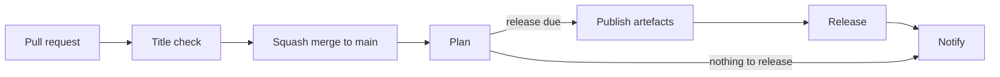

# Publish releases 🚀

- [Publish releases 🚀](#publish-releases-)
  - [Overview 🧭](#overview-)
  - [Quick reference for contributors 🔖](#quick-reference-for-contributors-)
    - [Name your pull request](#name-your-pull-request)
    - [Ship a breaking change](#ship-a-breaking-change)
    - [Merge without a release](#merge-without-a-release)
  - [How a release flows 🔄](#how-a-release-flows-)
  - [Set up a repository ⚙️](#set-up-a-repository-️)
    - [Required checks](#required-checks)
    - [Release App](#release-app)
    - [Organisation values](#organisation-values)
    - [Release commit signing](#release-commit-signing)
    - [Rulesets](#rulesets)
    - [Squash merging](#squash-merging)
  - [Versions and artefacts 📦](#versions-and-artefacts-)
    - [Why only VERSION changes](#why-only-version-changes)
    - [First release](#first-release)
    - [Publish artefacts safely](#publish-artefacts-safely)
    - [Publish a Docker image to Nexus](#publish-a-docker-image-to-nexus)
  - [Recovery runbook 🩺](#recovery-runbook-)
    - [Use Re-run failed jobs](#use-re-run-failed-jobs)
    - [Release settings are missing](#release-settings-are-missing)
    - [Authenticated dry run failed](#authenticated-dry-run-failed)
    - [Release step failed](#release-step-failed)
    - [Partial release](#partial-release)
    - [Partial image tags in Nexus](#partial-image-tags-in-nexus)
    - [Re-run with debug logging](#re-run-with-debug-logging)

## Overview 🧭

Every push to `main` can publish a release. The title of the pull request
decides whether it does and which version it gets. The repository uses
[semantic-release](https://semantic-release.gitbook.io/) with the Conventional
Commits preset. A release creates a commit signed by GitHub that updates
`VERSION`, a `vX.Y.Z` tag and a GitHub Release with notes.

This guide is for contributors who name pull requests and for maintainers who
set up a repository or recover a failed release.

The behaviour comes from these files:

- [`.releaserc`](../../../.releaserc) configures semantic-release
- [`pull-request-release-preview.yaml`](../../../.github/workflows/pull-request-release-preview.yaml)
  checks the title and description
- [`cicd-2-publish.yaml`](../../../.github/workflows/cicd-2-publish.yaml) plans,
  publishes and releases, and pins semantic-release and its plugins
- the release scripts in [`scripts/cicd`](../../../scripts/cicd)

## Quick reference for contributors 🔖

### Name your pull request

The repository squash merges every pull request. The squash commit takes the
pull request title as its subject, so the title must follow
[Conventional Commits](https://www.conventionalcommits.org/):

```text
type(optional scope): description
```

The type must be lowercase and a space must follow the colon. A scope holds
letters, digits, `.`, `_`, `/` or `-`. The examples assume an existing release
and no other unreleased commits. The highest change across all unreleased
commits decides the release. A first release starts at `1.0.0`:

| Title type                                      | Release        | Example                                 |
| ----------------------------------------------- | -------------- | --------------------------------------- |
| `feat`                                          | Minor, `1.2.0` | `feat(api): add patient search`         |
| `fix`                                           | Patch, `1.1.1` | `fix: handle an empty NHS number`       |
| `perf`                                          | Patch          | `perf(db): cache the lookup query`      |
| `refactor`                                      | Patch          | `refactor: split the validation module` |
| `revert`                                        | Patch          | `revert: feat(api): add patient search` |
| `build`, `chore`, `ci`, `docs`, `style`, `test` | None           | `docs: explain the release flow`        |
| Any type with `!` before the colon              | Major, `2.0.0` | `feat(api)!: remove the v1 endpoints`   |

The `🏷️ Check pull request title` check fails on any other title. It explains
the required format without suggesting a correction. It also rejects the skip
markers `[skip ci]`, `[ci skip]`, `[no ci]`, `[skip actions]`, `[actions skip]`,
`[skip release]` and `[release skip]` in the title or description, in any case.
The first five can stop the workflow. The last two exclude the squash commit
from release analysis. Do not add a `skip-checks: true` trailer, because it can
stop the workflow. The title check does not detect that trailer or skip-release
markers written with unusual Unicode spaces.

Edit the title and the check runs again. You do not need a new commit. No
predicted version or release notes preview is provided before the merge. Release
prediction runs in the push plan job after the merge to `main`.

### Ship a breaking change

Use either of these:

- Add `!` before the colon, for example `feat!: drop Python 3.12 support`.
- Start a line of the pull request description with `BREAKING CHANGE:` and
  explain the change after it. The description becomes the body of the squash
  commit, so the release reads it.

A breaking change creates a major release. Before `1.0.0`, it moves `0.x` to
`1.0.0`. The text after `BREAKING CHANGE:` appears in the release notes.

### Merge without a release

Use a type that does not release, such as `docs`, `chore`, `ci`, `build`,
`style` or `test`. When no earlier commits need a release, the publish workflow
finishes green without a notification. Do not use a skip marker. The title check
rejects it.

## How a release flows 🔄



1. **Pull request.** `🏷️ Check pull request title` checks the title and
   description.
2. **Squash merge.** GitHub creates one signed commit on `main` from the title
   and description.
3. **`🗓️ Plan the release`.** The job creates the release App token and runs
   an authenticated semantic-release dry run to determine the version. A
   failure here publishes nothing in the current attempt.
4. **`📦 Publish artefacts`.** The job runs `make publish` with `VERSION` set to
   the planned version.
5. **`🚀 Release`.** The job creates the App token and runs semantic-release.
   semantic-release writes `VERSION`. A local plugin then creates the release
   commit `chore(release): X.Y.Z [skip actions]` through the GitHub API, so
   GitHub signs it. semantic-release pushes the `vX.Y.Z` tag and creates the
   GitHub Release. It comments on the released pull request
   and labels it.
6. **`📣 Notify pipeline status`.** Teams gets `PUBLISHED: Release vX.Y.Z` when
   a release is published, and a message for any failed job. See
   [Configure pipeline notifications](./Configure_pipeline_notifications.md).

Concurrency never cancels a running publish run. It does not queue every push,
though. GitHub keeps at most one pending run, cancels an older pending run when
a newer one arrives and does not guarantee the order. See GitHub's
[concurrency documentation](https://docs.github.com/en/actions/how-tos/write-workflows/choose-when-workflows-run/control-workflow-concurrency).
After several quick merges, check the latest publish run and its outcome.

Deploy a release with the `🚀 CI/CD deploy` workflow and its `tag` input, for
example `v1.2.0`. It accepts only full stable version tags in the protected
`v*` namespace. It resolves the tag once and deploys that commit.

## Set up a repository ⚙️

A repository created from the template needs the steps in
[Set up a new repository](./Set_up_a_new_repository.md). This section explains
the release parts.

### Required checks

Require `🏷️ Check pull request title` in the `main` ruleset. It is the only
release-specific pull request check.

The title workflow runs only on `pull_request` events. To require the check for
a merge queue, add a `merge_group` trigger and adapt the check for merge-group
events. Its current inputs read the title and description from `pull_request`.

### Release App

The release uses a GitHub App, not `GITHUB_TOKEN`. The App bypasses the rulesets
on `main` and `v*` tags, so it can create the release commit and push tags.
`GITHUB_TOKEN` cannot bypass rulesets, and its pushes start no workflows.

The App needs these repository permissions:

| Permission    | Access         | Used for                                            |
| ------------- | -------------- | --------------------------------------------------- |
| Contents      | Read and write | Release commit, tags and GitHub Release             |
| Issues        | Read and write | Release labels and the failure issue                |
| Pull requests | Read and write | Release comments and labels on merged pull requests |
| Metadata      | Read           | Required by GitHub for every App                    |

The App must be installed on the repository. The plan job requests only contents
write, which its dry run needs to check push access. The release job requests
all three write permissions, so a missing issues or pull requests grant first
fails there, after the artefacts are published.

Every workflow job has only the permissions it needs. The App token exists only
in the plan and release jobs on `main`. Pull request jobs never receive it.

### Organisation values

The `nhs-england-tools` organisation already provides these values. A repository
needs no release configuration of its own once an organisation admin includes it
in the access policy of each value. A repository can set the unprefixed name to
override the organisation value.

| Kind     | Organisation name                           | Repository override                     | Used for                      |
| -------- | ------------------------------------------- | --------------------------------------- | ----------------------------- |
| Variable | `NHS_GH_VERSIONING_RELEASE_APP_ID`          | `GH_VERSIONING_RELEASE_APP_ID`          | App token in plan and release |
| Secret   | `NHS_GH_VERSIONING_RELEASE_APP_PRIVATE_KEY` | `GH_VERSIONING_RELEASE_APP_PRIVATE_KEY` | App token in plan and release |

Every push needs access to the release App ID and private key, even when it
does not release.

### Release commit signing

GitHub signs commits that a GitHub App creates through its API. The release
plugin `scripts/cicd/semantic-release-api-commit.mjs` creates the release commit
this way with the App token. GitHub shows it as verified. The author is the App
bot, such as `nhs-versioning-release-app[bot]`, and the committer is `GitHub`.

There is no signing key to import or rotate. The App private key is still a
shared organisation secret. A later change will replace it with short-lived
tokens from a central service.

The plugin checks its settings in the plan job dry run, so missing settings fail
there. It does not retry. If `main` moves during a release, the run fails
without a tag and the newer run releases.

### Rulesets

Template files cannot create rulesets, so set them up by hand:

- **Pull request ruleset on `main`.** Require a pull request and the
  [release-specific check](#required-checks). Add the release App to the
  bypass list with **Always**, so it can create the release commit.
- **Signed commits ruleset on `main`.** Require signed commits and leave the
  bypass list empty. A bypass covers a whole ruleset, so keeping this rule
  separate makes the App's own commits need a signature too.
- **Tag ruleset on `v*`.** Restrict creations, updates and deletions. Add only
  the release App to the bypass list. The deploy workflow trusts these tags, so
  nobody else should create or move them.

Confirm that both branch rulesets are active and target `main`. A ruleset that
targets no branches does not protect it.

### Squash merging

In **Settings**, under **Pull Requests**, allow squash merging only. Set the
default squash commit message to **Pull request title and description**. The
release reads the type from the title and breaking changes from the description.

Contributors must also sign their branch commits. See
[Sign Git commits](./Sign_Git_commits.md#signed-commits-on-main-).

## Versions and artefacts 📦

### Why only VERSION changes

The release commit changes only the root `VERSION` file. The notes live in the
GitHub Release and in the body of the release commit. There is no
`CHANGELOG.md`, so a release never conflicts with open pull requests. The
`[skip actions]` marker stops the release commit from starting another run.

The plugin resets the checkout to the API-created commit. It discards any other
uncommitted files that a prepare step writes, so list such files in the `assets`
of the plugin in `.releaserc`.

The notes list features, bug fixes, performance improvements, code refactoring
and reverts. They hide `build`, `chore`, `ci`, `docs`, `style` and `test`
changes.

### First release

With no `vX.Y.Z` tag yet, the first release is `1.0.0`. It replaces the initial
`0.0.0` in the template's `VERSION` file. semantic-release ignores tags that are
not versions.

To start at `0.x` instead, create a `v0.0.0` tag on an earlier commit before the
first release is due and before you add the tag ruleset. The next `feat` then
releases `0.1.0`. A breaking change still moves to `1.0.0`.

### Publish artefacts safely

`📦 Publish artefacts` runs `make publish` before the release exists. If the
release then fails, a rerun publishes again. If the run is superseded, the next
run publishes newer content, maybe under the same version. Write `make publish`
so that it is safe to repeat for the same version.

### Publish a Docker image to Nexus

The publish job holds commented steps that build an image and push it to a Nexus
Docker repository. Before you enable them:

- Replace `[sample-url]` with the HTTPS Docker registry endpoint of a writable
  Nexus repository. It is a placeholder, not a real address.
- Add the `NEXUS_USERNAME` and `NEXUS_PASSWORD` Actions secrets for an account
  scoped to that repository. Your team provides these credentials. Nexus uses
  its own credentials, so the job needs no `packages: write` permission.
- Make sure the runner can reach the registry.
- Set `IMAGE_DIR` and `IMAGE_NAME`, and confirm the Nexus repository lets the
  job update `latest`.
- Raise the job's `timeout-minutes`, because a build takes longer than three
  minutes.

The steps pass `IMAGE_DIR` as `docker_dir` and use the repository root as the
build context. A service with its own context or a module-scoped platform needs
its service Makefile or named module target instead. See
[Build Docker images](./Build_Docker_images.md#use-a-different-image-directory)
and [Platform architecture](./Build_Docker_images.md#platform-architecture).

The steps write the planned version to `$IMAGE_DIR/VERSION` in the job workspace
only, then push that version and `latest`. The override is not part of the
release commit and does not change the committed image `VERSION` file.

## Recovery runbook 🩺

Each entry starts with the message the workflow prints. A failure does not
prove that earlier attempts published nothing. Check the run history and the
release and artefact state before recovery. Never move, delete or recreate an
existing release tag by hand. The deploy workflow trusts these tags.

On failure, semantic-release also opens an issue labelled `semantic-release`.
The next successful release closes it. Release commit failures from the release
step open no issue. The Teams notification and the run log are the signal.

### Use Re-run failed jobs

Use **Re-run failed jobs** after correcting a failure that happened before the
release was created. A failed release job reuses the planned version. A failed
plan job runs the dry run again. Artefact publication must be safe to repeat.

After a partial release, check the tag and GitHub Release on GitHub before
rerunning. The workflow does not verify or repair an earlier partial release. A
rerun may finish green without publishing anything. See
[Partial release](#partial-release).

### Release settings are missing

"The release commit settings are incomplete, so nothing was released:"

The plugin lists each problem. The plan job dry run reports it first, so no
artefacts exist yet. If the release job reports it, artefacts may exist.

A missing App ID or private key can also cause
`🔐 Create the release App token` to fail. In the plan job,
read the `🔐 Create the release App token` step log. The same applies in the
`🚀 Release` job.
Artefacts may already exist.

Fix any incorrect repository overrides. If a required
[organisation value](#organisation-values) is missing, ask an organisation admin
to grant the repository access to it. For an App token failure, check that the
App ID and private key are current, that the App is installed on the repository
and that it has the [required permissions](#release-app).

Follow [Use Re-run failed jobs](#use-re-run-failed-jobs).

### Authenticated dry run failed

These failures publish no artefacts or release in the current plan-job attempt.
Fix the cause, then use **Re-run failed jobs**.

Read the error in the `🔏 Plan the release` step. Check that the App is
installed, has every requested [permission](#release-app), and bypasses the
rulesets on `main` and `v*` tags.

### Release step failed

The `🚀 Release` step shows a semantic-release error. Read the error:

- "`main` moved after this run started, so GitHub did not create the release
  commit and nothing was released": the newer publish run releases it. Check
  that run and do not rerun this one.
- "GitHub refused the release App's request to create the release commit":
  check that the App is installed, has contents read and write permission and
  is on the bypass list of the `main` ruleset. Then use **Re-run failed jobs**.
- "GitHub created the release commit … but this job could not check it out, so
  no tag was created. Do not rerun": follow
  [The tag does not exist](#the-tag-does-not-exist).
- "GitHub refused …" or "GitHub did not create the release commit …": a ruleset
  on `main` may have rejected the request. Add the App to the bypass list of
  the pull request ruleset.
- "The request to GitHub … failed (…), so this job cannot tell whether GitHub
  created it", "GitHub answered … with HTTP 5xx, so this job cannot tell whether
  GitHub created it" or "GitHub returned an unexpected response …": GitHub may
  already have created the commit. A rerun after that finishes green with no
  tag and no notification. Check `main` first. If a
  `chore(release): X.Y.Z [skip actions]` commit is at its tip, follow
  [The tag does not exist](#the-tag-does-not-exist). Otherwise use
  **Re-run failed jobs**.
- "semantic-release gave no valid commit to release…" or "…runs outside the
  repository's top-level directory…": nothing was released. Run
  semantic-release from the repository's top-level directory, then use
  **Re-run failed jobs**.
- "The release asset … was deleted": nothing was released. The plugin only adds
  or updates files. Check `assets` in `.releaserc` and any prepare step that
  deletes one of those files, then use **Re-run failed jobs**.
- "GitHub did not create the release commit on `main` (HTTP …)": nothing was
  released. This covers HTTP 4xx and GraphQL errors. Check the status code in
  the message and [GitHub status](https://www.githubstatus.com/), then use
  **Re-run failed jobs**.

The authenticated dry run in the plan job checks that the token can push. It
uses `git push --dry-run`, which sends no update, so it cannot prove that the
real release commit or tag will pass every ruleset. A ruleset rejection can
therefore first appear here. If no release commit reached `main`, fix the cause,
then use **Re-run failed jobs**. Artefacts may already exist. If the release
commit reached `main`, check the exact planned version tag vX.Y.Z on GitHub in
**Code** > **Tags**, not in local tags. If it is missing, stop and follow
[The tag does not exist](#the-tag-does-not-exist) without rerunning. If the
lookup fails or you cannot verify access, stop and escalate to the repository
owners and the organisation's GitHub administrators. If the tag exists, check
the GitHub Release before deciding how to recover.

### Partial release

Inspect the release commit, version tag, GitHub Release and artefacts on
GitHub. The workflow does not check whether a release is complete or matches
the planned version.

#### The tag does not exist

The tag push may have failed or been rejected by the `v*` tag ruleset, for
example if the App is not on its bypass list. Check the release error before
attributing the cause. The release commit is on `main`, the artefacts are
published and no tag or GitHub Release exists. A rerun cannot fix this, because
semantic-release finds no new commit to release.

Recovery is blocked. The template has no verified procedure that creates the
missing tag as the release App. Only the App may create `v*` tags, and the
deploy workflow trusts them, so:

1. Do not create, move or delete the tag yourself. Do not add people or other
   apps to the bypass list of the tag ruleset.
2. Do not deploy the release commit or the published artefacts.
3. Add the release App to the bypass list of the tag ruleset, so later releases
   can push their tags.
4. Escalate to the repository owners and the organisation's GitHub
   administrators. Give them the run link, the release commit and the planned
   version. They decide how to complete or abandon the release under an approved
   procedure.

#### The GitHub Release does not exist

The tag exists, but its GitHub Release does not. A maintainer can create the
GitHub Release from the existing tag. This does not create or move a tag.

1. On GitHub, find the exact remote tag vX.Y.Z in **Code** > **Tags** and open
   its commit. Check that it is the release commit,
   `chore(release): X.Y.Z [skip actions]`, on `main`. Inspect the commit for
   both lightweight and annotated tags, not an annotated tag object. If the
   tag is missing, access or lookup fails, or the commit is wrong, stop and
   escalate as for [a missing tag](#the-tag-does-not-exist). Do not rely on a
   local tag.

2. Copy the release commit's message body into `notes.md`, then create the
   GitHub Release. `--verify-tag` makes the command fail rather than create a
   tag. If it fails, including an access or lookup failure, stop and escalate.

   ```shell
   gh release create vX.Y.Z --verify-tag --title vX.Y.Z --notes-file notes.md
   ```

### Partial image tags in Nexus

When the Nexus example is enabled and a push fails, some image tags may exist in
Nexus without a GitHub Release. `latest` may point at the unreleased image. Look
at the tags for the planned version before a rerun. If the Nexus repository
blocks redeploys, remove the partial tag under your Nexus policy. Then use
**Re-run failed jobs**.

### Re-run with debug logging

Open the failed run, choose **Re-run failed jobs** and tick **Enable debug
logging**. The semantic-release steps then set `DEBUG=semantic-release:*` and
log every plugin decision. GitHub masks secrets in the log.
